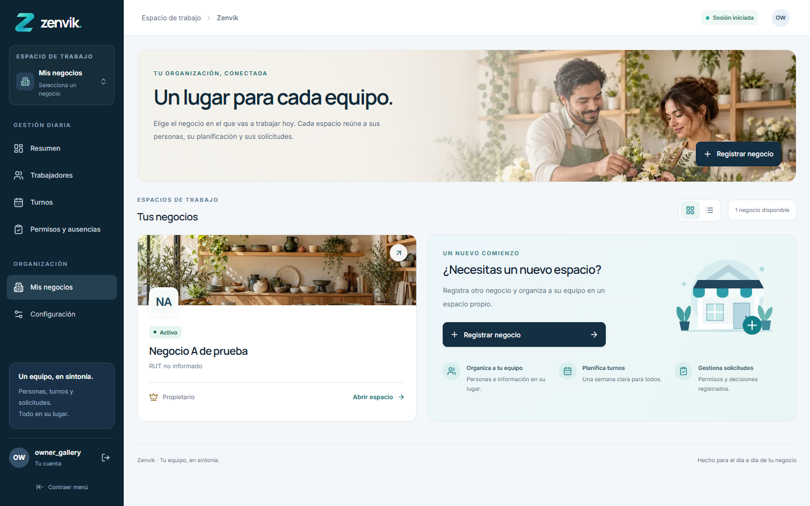
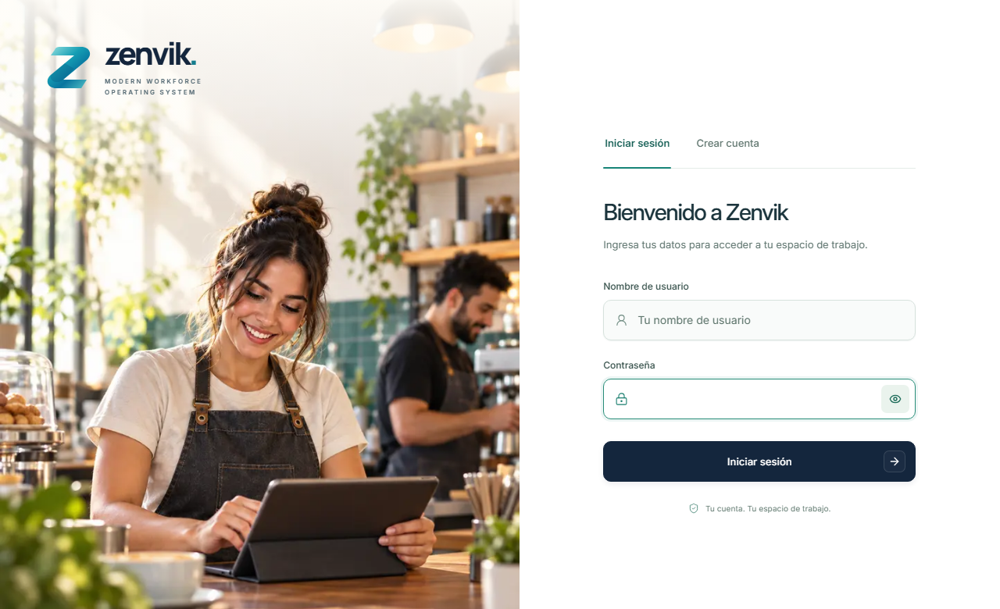
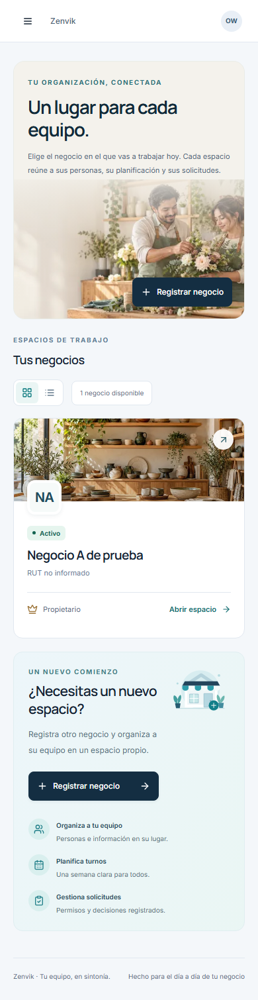

# Zenvik

SaaS de gestión de equipos para pequeñas empresas chilenas. Reúne negocios, trabajadores, planificación de turnos y solicitudes de permisos en un mismo espacio, con acceso según membresía y rol.

**Estado: MVP funcional en desarrollo local, con rediseño Zenvik 2.0 y pruebas automatizadas. Preparación para piloto pendiente. No está desplegado ni habilitado para operación comercial pública.**

## Vista del producto

Las capturas corresponden a pruebas locales con datos sintéticos; no muestran clientes reales. Las fotografías de marca son ilustrativas, generadas para el proyecto.



| Inicio de sesión | Versión móvil |
| --- | --- |
|  |  |

Más pantallas: [dashboard](docs/screenshots/dashboard.png), [trabajadores](docs/screenshots/directory.png), [perfil](docs/screenshots/profile.png), [turnos](docs/screenshots/shifts.png) y [solicitudes](docs/screenshots/leaves.png).

## Stack

Versiones de aplicación fijadas en `requirements.txt` y `package-lock.json`:

| Capa | Tecnologías |
| --- | --- |
| Backend | Python; Django 5.2.18; Django REST Framework 3.18.3 |
| Base de datos | PostgreSQL 17 mediante Docker Compose; psycopg 3.3.6 |
| Configuración | django-environ 0.14.0; variables locales fuera de Git |
| Frontend | Next.js 16.4.3 App Router; React 19.3.1; TypeScript 5.9.3 |
| Interfaz | Tailwind CSS 4.3.3; Radix UI; componentes locales; Lucide; Inter y Manrope autoalojadas |
| Formularios | React Hook Form; Zod |
| Autenticación | Sesiones Django, cookies HttpOnly y CSRF; integración opcional con Cloudflare Turnstile |
| Calidad | Pruebas Django sobre PostgreSQL, Vitest, Playwright, ESLint y TypeScript |

Entorno local utilizado: Windows/PowerShell, Python 3.15.0 y Node.js 24.22.0. Antes del despliegue debe fijarse y verificarse la matriz de versiones soportadas del runtime; la ejecución local no sustituye esa revisión.

## Funciones implementadas

- Registro e inicio/cierre de sesión; usuario personalizado con UUID y correo único.
- Creación y selección de negocios; RUT opcional con formato y dígito verificador validados. Esa validación no verifica titularidad ante el SII.
- Membresías OWNER, ADMIN y EMPLOYEE; autorización y consultas limitadas al negocio correspondiente.
- Trabajadores con o sin cuenta, directorio, búsqueda, filtros, perfil y desactivación con confirmación.
- Turnos semanales y vista de agenda, detección de conflictos, edición y cancelación conservando historial.
- Solicitudes de permisos y ausencias, aprobación/rechazo por responsables, cancelación e historial de decisiones.
- Portal del trabajador con sus turnos, ficha y solicitudes; dashboard con información real del negocio.
- Diseño adaptable, menú contraíble, navegación por teclado, estados de carga/error y movimiento reducido.

La configuración de cuenta es de consulta: todavía no ofrece edición de perfil ni administración de membresías. No se implementan remuneraciones, asistencia electrónica, nómina ni vacaciones legales.

## Fase actual y próximos pasos

| Etapa | Estado |
| --- | --- |
| 1 · Backend y PostgreSQL | Implementado |
| 2 · Modelos y migraciones iniciales | Implementado y aplicado en desarrollo |
| 3 · API, sesión y separación por negocio | Implementado con pruebas de roles y aislamiento |
| 4 · Frontend conectado a Django | Implementado |
| 5 · Turnos y calendario semanal | Implementado |
| 6 · Permisos, ausencias y aprobaciones | Implementado |
| 7 · Revisión local de seguridad y QA | Ejecutada; quedan controles operativos pendientes |
| Zenvik 2.0 · Rediseño visual | Implementado; acceso y espacios de trabajo refinados |
| Piloto y producción | Pendiente de preparación y verificación |

Pendientes principales:

- Configurar claves reales de Turnstile y validar el proveedor. La integración está preparada; localmente está desactivada y las pruebas usan un proveedor simulado.
- Definir staging y despliegue HTTPS con servidor de aplicación, red privada y cadena de proxies confiables.
- Separar roles de base de datos para ejecución y migraciones; el rol de desarrollo no debe utilizarse en producción.
- Automatizar respaldos cifrados externos, restauraciones periódicas, observabilidad y alertas.
- Diseñar recuperación de contraseña, verificación de correo y gestión de membresías antes de ampliar el acceso.
- Revisar CSP, límites por IP real y requisitos del piloto; no se afirma certificación de seguridad ni cumplimiento laboral avanzado.

Detalles: [auditoría de seguridad](SECURITY.md), [operación y recuperación](OPERATIONS.md), [Turnstile](TURNSTILE.md) y [estado del proyecto](docs/PROJECT-STATUS.md).

## Ejecutar localmente

Requiere Git, Docker con Compose, Python y Node.js/npm. Los comandos siguientes parten de la raíz del repositorio, en PowerShell.

1. Crear la configuración local y completar secretos propios; nunca subir `.env`:

   ```powershell
   Copy-Item .env.example .env
   ```

   Si `.env` ya existe, conservarlo. Reemplazar los marcadores de contraseña y `DJANGO_SECRET_KEY` antes de continuar.

2. Iniciar PostgreSQL y preparar el backend en una copia nueva:

   ```powershell
   docker compose up -d db
   python -m venv apps/api/.venv
   .\apps\api\.venv\Scripts\python.exe -m pip install -r apps/api/requirements.txt
   .\apps\api\.venv\Scripts\python.exe apps/api/manage.py check
   .\apps\api\.venv\Scripts\python.exe apps/api/manage.py migrate
   .\apps\api\.venv\Scripts\python.exe apps/api/manage.py runserver 127.0.0.1:8000
   ```

   En una instalación existente se conserva el entorno virtual y se revisa el estado de migraciones antes de aplicarlas. No borrar volúmenes para actualizar el proyecto.

3. En otra terminal, desde la raíz:

   ```powershell
   cd apps/web
   npm.cmd ci
   npm.cmd run dev
   ```

Abrir **http://127.0.0.1:3000**. Crear una cuenta, iniciar sesión y registrar un negocio. No se incluyen usuarios ni credenciales de acceso predefinidos.

PostgreSQL local escucha en `127.0.0.1:5435`; Django en `127.0.0.1:8000`. Next reenvía la API desde el mismo origen. Los parámetros opcionales de Next están documentados en [apps/web/README.md](apps/web/README.md).

## Verificación

```powershell
.\apps\api\.venv\Scripts\python.exe apps/api/manage.py check
.\apps\api\.venv\Scripts\python.exe apps/api/manage.py test
cd apps/web
npm.cmd run typecheck
npm.cmd run lint
npm.cmd test
npm.cmd run build
```

Las pruebas Django requieren un PostgreSQL de pruebas y permiso para crear una base temporal. Nunca apuntar las pruebas a producción ni aceptar borrar una base existente sin comprobar su origen.

Para los flujos completos de navegador, después del build, desde la raíz:

```powershell
.\apps\api\.venv\Scripts\python.exe apps/api/run_browser_tests.py
```

El runner crea una base con nombre único, sirve la API real y ejecuta Chromium contra Next en el puerto 3100. Los navegadores se instalan con `npx.cmd playwright install chromium` desde `apps/web` si todavía no están disponibles. La base temporal se elimina al finalizar; los datos de desarrollo no se usan como fixtures.

La evidencia y las limitaciones de cada suite se detallan en [docs/PROJECT-STATUS.md](docs/PROJECT-STATUS.md). No existe todavía un pipeline CI configurado.

## Estructura y documentación

```text
apps/api/          Django, modelos, servicios, API, migraciones y pruebas
apps/web/          Next.js, componentes, recursos y pruebas de navegador
docs/              Estado del MVP y capturas publicables
compose.yml        PostgreSQL local con volumen persistente
.env.example       Plantilla de configuración sin credenciales reales
```

- [Referencia de API](apps/api/API.md)
- [Modelo relacional y validaciones](apps/api/businesses/README.md)
- [Frontend y configuración](apps/web/README.md)
- [Rediseño Zenvik 2.0](ZENVIK-2.0.md)
- [Recursos visuales de autenticación](AUTH-IMAGERY.md)
- [Diseño de espacios de trabajo y prompts de imágenes](WORKSPACE-VISUAL.md)
- [Galería y procedencia de capturas](docs/screenshots/README.md)

Las fuentes incluyen sus licencias OFL. No se ha definido todavía una licencia general de distribución para el código del proyecto.
