# Zenvik — Etapa 12: asistencia con geolocalización puntual

## Estado de entrega

Etapa implementada y verificada localmente. Los quince criterios técnicos de aceptación tienen evidencia, incluida la documentación de brechas normativas. No se presenta Zenvik como reloj control certificado ni autorizado por la Dirección del Trabajo.

## Auditoría y decisiones

Se leyeron los informes de las etapas 8–11 y la propuesta de asistencia. Se inspeccionaron modelos, relaciones, permisos, servicios transaccionales, sesiones Django, CSRF, cookies, proxy Next.js, navegación, calendario, perfil y suites reales. La base de Etapa 11 tenía portal operativo y pruebas aprobadas; se reutilizó, sin duplicar User, Business, Membership, Employee ni Shift.

La investigación normativa cambió una decisión de implementación: la distancia a una geocerca produce una incidencia y no bloquea la marcación. La evaluación preliminar y sus fuentes oficiales están en [STAGE-12-COMPLIANCE.md](STAGE-12-COMPLIANCE.md). La propuesta de Etapa 11 era conceptual: esta entrega utiliza los nombres definitivos `CLOCK_IN`, `BREAK_START`, `BREAK_END`, `CLOCK_OUT` y `NOT_STARTED`, `WORKING`, `ON_BREAK`, `FINISHED` solicitados en el prompt.

## Arquitectura

```mermaid
flowchart LR
  Portal[Mi asistencia] --> Confirmacion[Confirmación explícita]
  Confirmacion --> GPS[Una lectura de ubicación]
  GPS --> API[Proxy mismo origen / sesión / CSRF]
  API --> Servicio[Identidad y política en servidor]
  Servicio --> Lock[Transacción y bloqueo del negocio]
  Lock --> Estado[Estado y versión esperados]
  Estado --> Registro[Evento inmutable + jornada]
  Registro --> Comprobante[Comprobante persistido]
```

`apps/api/attendance/` concentra modelos, serializadores estrictos, servicios, vistas, rutas, migraciones y pruebas. El frontend utiliza los componentes visuales, sesión, hooks y `BusinessGate` existentes. Ningún componente solicita GPS al cargar la página o iniciar sesión.

## Modelos y migraciones

| Modelo | Datos y garantías |
| --- | --- |
| `AttendanceSession` | UUID, negocio, ficha, usuario original, turno opcional, fotografía del horario programado, fecha laboral, zona IANA, estado, versión y timestamps. Restricción única parcial: solo una jornada abierta por ficha y negocio. |
| `AttendanceEvent` | UUID, jornada, negocio, trabajador y actor; nombres conservados; tipo, instante oficial, secuencia, request UUID, hash del payload, coordenadas opcionales, precisión, estado de ubicación, incidencia, política aplicada y hashes de integridad. |
| `AttendancePolicy` | Política por negocio: ubicación requerida en flujo ordinario, precisión deseada, plazo de revisión de conservación, versión y actualización. |
| `AttendanceSite` | Ubicación autorizada con nombre, coordenadas reales aportadas por administración, radio, actividad y fechas. |
| `AttendancePolicyRevision` | Revisión inmutable con autor, fecha y fotografía de la configuración. |

Migraciones nuevas y aditivas:

- `0001_initial`: tablas, índices y restricciones.
- `0002_immutable_records`: triggers PostgreSQL que impiden UPDATE/DELETE de eventos y revisiones de política, y comprueban correspondencia de identidad del evento con su jornada.
- `0003_remove_attendanceevent_attendance_valid_location_and_more`: valida que la ubicación esté completamente ausente o tenga las tres magnitudes válidas; evita coordenadas parciales por semántica NULL de SQL.

Se aplicaron en PostgreSQL **17.11** local. Antes y después se compararon conteos y hashes de todos los campos de Business, Employee, Membership, Shift y LeaveRequest: coincidencia exacta. No se insertaron marcaciones, geocercas ni datos de prueba en esa base. Evidencia: [stage12-migration.log](../.artifacts/stage12-migration.log). Las fixtures GPS viven únicamente en bases temporales de pruebas.

Los tests de migración anteriores ahora restauran todas las hojas del grafo, incluyendo la nueva app dependiente; se conserva su comprobación de datos históricos. No se desactivaron pruebas.

## Flujo y reglas

| Estado | Acción permitida | Resultado |
| --- | --- | --- |
| NOT_STARTED (virtual, sin jornada) | CLOCK_IN | Nueva jornada WORKING, versión 1 |
| WORKING | BREAK_START | ON_BREAK |
| ON_BREAK | BREAK_END | WORKING |
| WORKING | CLOCK_OUT | FINISHED |
| FINISHED | Ninguna sobre esa jornada | Original cerrado conservado |

Se permiten jornadas sin colación y múltiples ciclos de descanso. Para trabajar otra vez después de finalizar existe una acción explícita «Comenzar otra jornada», que crea un nuevo UUID; nunca reabre ni escribe sobre la finalizada. No se permite terminar jornada durante una colación abierta: debe cerrarse la colación; los errores históricos requieren una futura corrección auditada.

El servidor toma la hora después de adquirir el bloqueo. Ignora como fuente de verdad cualquier reloj de navegador: los campos de hora oficial enviados por el cliente se rechazan. La fecha laboral es la fecha local del inicio del turno asociado, o del CLOCK_IN cuando no hay turno. Una jornada abierta continúa al cruzar medianoche. La asociación selecciona en servidor el primer turno programado aún no terminado cuyo inicio sea anterior al siguiente día local; admite el turno nocturno ya iniciado o el siguiente de hoy. No depende de un ID de trabajador o turno elegido por el cliente.

El turno original no se modifica. Se conserva una fotografía de su horario al abrir la jornada. No se calculan sanciones, atrasos, horas extraordinarias ni descuentos. Los eventos efectivamente registrados se distinguen del horario programado.

Cada petición contiene `request_id`, `session_id` y `expected_version`. Una repetición con misma clave y contenido devuelve el mismo comprobante. Una clave reutilizada con distinto contenido o estado obsoleto produce 409. La interfaz conserva la petición en memoria al perder la respuesta y reenvía exactamente la misma, sin volver a capturar GPS. Una respuesta perdida después de persistir se prueba en E2E.

## API

Prefijo: `/api/v1/businesses/{business_id}/attendance/`.

| Método y ruta | Función / autorización |
| --- | --- |
| GET `current/` | Estado propio, acciones permitidas, ficha elegible, jornada, turno, política y últimas 50 marcaciones de la fecha local |
| POST `events/` | Marcación propia: identidad resuelta con sesión, membresía y ficha activa; transacción y límites |
| GET `history/?date_from=&date_to=&page=` | Jornadas propias, fechas laborales inclusivas, 10 por página y eventos por secuencia |
| GET `receipts/{event_id}/` | Comprobante propio; 404 uniforme para ajeno/desconocido |
| GET `policy/` | Política aplicable del negocio autorizado |
| PUT `policy/` | OWNER/ADMIN; versión obligatoria, revisión auditada y zonas del mismo negocio |

POST admite solamente `event_type`, `request_id`, `session_id` (null para nueva jornada), `expected_version`, `location`, `location_status` y `exception_reason`. `location` contiene latitud, longitud y precisión, o null. No admite `employee_id`, `user`, negocio alternativo, rol ni hora oficial. Nuevos eventos retornan 201; replay 200; validación 400; CSRF/rol 403; recurso ajeno 404; conflicto 409; límite 429. No hay endpoints PATCH/DELETE para originales.

## Geolocalización y geocercas

- `getCurrentPosition`, una lectura al pulsar «Confirmar y obtener ubicación», `maximumAge=0`, timeout 12 s y precisión alta solicitada. No hay `watchPosition`, rutas ni seguimiento en segundo plano.
- Se explican finalidad, datos, acceso restringido y ausencia de seguimiento antes de la captura. Los estados diferencian permiso denegado, ubicación indisponible/GPS apagado, timeout, navegador incompatible y contexto inseguro.
- Producción exige HTTPS; localhost es contexto seguro de desarrollo del navegador. `Permissions-Policy` permite geolocalización únicamente al mismo origen y mantiene cámara/micrófono bloqueados. Se aplica al documento de la app para que la navegación cliente no herede una prohibición de la página anterior. Permitir la API no concede por sí mismo permiso GPS: el navegador y la acción explícita siguen siendo necesarios.
- Validación de números finitos, latitud ±90, longitud ±180 y precisión de 0 a 100.000 m; sin coordenadas parciales. No se devuelven coordenadas en errores.
- Geocercas múltiples con distancia Haversine. `INSIDE` si el círculo de precisión cabe dentro de una zona; `UNCERTAIN_BOUNDARY` si intersecta el borde; `OUTSIDE` si queda fuera de todas; `LOW_ACCURACY` si supera el umbral; `NO_GEOFENCE` cuando no hay zonas activas; `MISSING_LOCATION` sin coordenadas.
- Todos esos resultados se conservan con la marcación. La ubicación fuera de zona o imprecisa no se descarta. Cuando se exige ubicación y no está disponible, se requiere una explicación de al menos diez caracteres para la excepción. No se inventan coordenadas.
- Se admiten hasta veinte ubicaciones por negocio, radio 10–100.000 m y precisión deseada 1–10.000 m. Son límites técnicos, no normas laborales. Las zonas pueden editarse o desactivarse; los eventos conservan la política que se les aplicó.

Sin configuración, no hay geocercas ni ubicaciones inventadas: precisión deseada 100 m, ubicación opcional, revisión de conservación no definida. Administración puede configurar estos parámetros desde un diálogo funcional, sin construir el panel supervisor de Etapa 13.

## Interfaz y comprobantes

Ruta nueva `/app/[businessId]/asistencia`, accesible desde sidebar, inicio y barra móvil. `attendance-workspace.tsx` contiene estado, cuatro controles, confirmación, excepción, comprobante, historial y filtros. `attendance-policy.tsx` configura política y varias ubicaciones. `lib/attendance.ts` concentra contratos, etiquetas y lectura puntual. El portal conserva la identidad visual existente.

Se muestra el estado real del backend; los cuatro controles se habilitan solo cuando corresponde y se bloquean durante el envío. No se anuncia éxito antes de recibir un comprobante persistido. Se puede consultar cada comprobante desde la jornada, los eventos de hoy o el historial, y descargar su JSON sin nuevas dependencias. Incluye UUID, nombres, tipo, instante oficial, resultado geográfico, precisión y explicación cuando aplica; JSON incluye el hash. No incluye coordenadas personales en la respuesta ordinaria.

El historial filtra por fecha laboral; la sección «Marcaciones de hoy» filtra por fecha calendario local, para conservar visibilidad de una salida nocturna aunque la jornada pertenezca a ayer. Las jornadas previas están paginadas. Carga, vacío, errores y reintento usan los componentes existentes.

## Seguridad, privacidad y límites

- Sesión Django, cookies HttpOnly, CSRF y permisos anteriores conservados. Membresía/negocio activos y acceso habilitado se comprueban en cada petición y nuevamente dentro de la transacción de escritura.
- Todo endpoint de registros es propio, incluso para OWNER/ADMIN. Configurar geocercas no concede acceso a marcaciones ajenas. Se conserva el usuario original del evento: reasignar una ficha no transfiere silenciosamente sus comprobantes a otra cuenta.
- Bloqueo por negocio compartido con la administración de fichas, restricciones PostgreSQL, secuencia única y request UUID único por usuario/negocio. El límite de POST es 30 intentos por minuto por usuario/negocio, compartido en PostgreSQL mediante el mecanismo de reservas existente; también cuenta peticiones inválidas.
- Triggers protegen los originales incluso frente a update/delete de QuerySet. Hashes encadenados permiten comprobación técnica; no son firma externa ni defensa contra un superusuario que cambie la infraestructura.
- No se registran coordenadas, cuerpo, IP ni huella de dispositivo en logs de la aplicación. Se reutiliza el middleware de errores que registra únicamente método, estado y tipo de error. No se guardan ubicaciones en localStorage/sessionStorage; el reintento solo vive en memoria de la pantalla.
- Respuestas no-store, filtros por actor/negocio, prefetch de eventos y paginación. La jornada actual y cada jornada histórica incluyen todos sus eventos: no se hizo una prueba de carga con jornadas patológicas de miles de descansos.
- Sin red no hay marcación confirmada ni reloj offline. Se muestra error y se puede reintentar; cerrar la pantalla pierde la petición pendiente en memoria, pero se puede consultar el registro persistido. Un mecanismo offline duradero requiere diseño separado.
- No hay correcciones, revisión administrativa de incidencias, envío por correo, portal fiscalizador ni certificación. Son brechas expresas de la matriz normativa y preparación para siguientes etapas.
- `retention_days` es un plazo configurable de revisión, no un borrado automático ni una afirmación de conservación legal. Deben definirse política jurídica y disposición auditada antes de uso real.

## Pruebas y resultados

| Verificación | Resultado |
| --- | --- |
| Backend completo, `run_backend_tests.py` | 236 descubiertas: 230 aprobadas, 6 lanzadores E2E separados |
| Frontend Vitest | 88 aprobadas en 13 archivos |
| TypeScript | Aprobado, incluida comprobación final de los tests E2E |
| ESLint | Aprobado, sin advertencias |
| Build Next.js | Aprobado, ruta de asistencia incluida |
| E2E de asistencia | 3 aprobados contra API real y GPS simulado |
| Regresión E2E completa y repetición de fases corregidas | 39 casos aprobados: 29 generales, 2 personal, 1 planificación, 2 portal, 2 Turnstile y 3 asistencia |
| Migración local PostgreSQL 17.11 | Aplicada; datos anteriores idénticos por conteo y hash |

Backend nuevo: flujo completo, transiciones prohibidas, jornada sin descanso y con múltiples descansos, cierre irreversible, nuevas jornadas, idempotencia y contenido conflictivo, concurrencia de claves iguales/distintas, noche/fecha laboral, eventos del día posterior, turno original conservado, campos de identidad/hora rechazados, coordenadas inválidas, geocercas múltiples/límite/precisión, excepción sin GPS, privacidad de comprobantes, acceso suspendido/ficha inactiva, CSRF, métodos, filtros, versión obsoleta, rate limiting e inmutabilidad SQL.

Frontend: habilitación de las cuatro acciones, bloqueo mientras envía, captura única no cacheada, permiso denegado, GPS no disponible, timeout, inseguridad HTTPS, navegador incompatible, fallo síncrono, datos no finitos y hora de Santiago. E2E: cuatro marcas, respuesta perdida tras persistir y replay sin duplicado, descarga/consulta, historial, repetición inválida, acceso ajeno, excepción por permiso denegado, precisión insuficiente, configuración multizona y navegación real del portal a 320 px.

Evidencias: [backend](../.artifacts/stage12-backend.log), [E2E de asistencia](../.artifacts/stage12-attendance-e2e.log), [regresión E2E](../.artifacts/stage12-e2e.log), [repetición final de personal y asistencia](../.artifacts/stage12-e2e-final.log), [migración](../.artifacts/stage12-migration.log). Los runners crean bases temporales únicas y las retiran al finalizar; no borran la base real.

Problemas resueltos durante implementación: formato horario fijado a 24 horas, fixture nocturna separada de la caducidad de sesión, condición SQL de coordenadas NULL, restauración de apps dependientes en pruebas antiguas y permiso GPS compatible con navegación cliente. La regresión completa detectó además un selector ambiguo de una prueba anterior: el teléfono figuraba en la ficha visible y en el historial cerrado. Se corrigió la selección para comprobar la definición visible, conservando todas las aserciones. Esa fase y la de asistencia se repitieron y aprobaron; el log completo conserva el fallo inicial y el log final contiene las fases corregidas. Los diez skips de Playwright en la fase general son casos ejecutados en las otras cinco fases aisladas, no casos eliminados. No se relajaron las aserciones de autorización.

## Evidencia visual

- [Jornada finalizada a 320 px](../.artifacts/stage12/attendance-finished-320.png).
- [Comprobante a 320 px](../.artifacts/stage12/attendance-receipt-320.png).
- [Excepción GPS móvil](../.artifacts/stage12/attendance-exception-mobile.png).
- [Asistencia en escritorio](../.artifacts/stage12/attendance-desktop.png).

Capturas finales de datos sintéticos revisadas visualmente. Las capturas de página completa incluyen elementos fijos en la posición del viewport; su posición en la imagen extendida no representa el comportamiento durante scroll. Se verifican controles táctiles, no desborde a 320 px, diálogos y Escape; no se afirma una auditoría formal de lectores de pantalla ni de todos los navegadores móviles.

## Checklist de aceptación

| # | Criterio | Evidencia / estado |
| --- | --- | --- |
| 1 | Inicio de turno | Servicio CLOCK_IN y E2E |
| 2 | Inicio de colación | Transición WORKING → ON_BREAK y E2E |
| 3 | Término de colación | Transición ON_BREAK → WORKING y E2E |
| 4 | Término de turno | Transición a FINISHED y E2E |
| 5 | Persistencia | API real, conteo de cuatro eventos y consulta posterior |
| 6 | Ubicación puntual autorizada/disponible | Una llamada por confirmación, GPS simulado y excepciones |
| 7 | Geocercas | Distancia, incertidumbre, precisión y múltiples zonas probadas |
| 8 | Transiciones inválidas bloqueadas | Tests backend y repetición E2E |
| 9 | Duplicados/concurrencia | Restricciones, locks y pruebas concurrentes/replay |
| 10 | Comprobantes reales | UUID persistido, consulta y descarga E2E |
| 11 | Historial propio | Fechas, paginación, jornadas y eventos del día |
| 12 | Aislamiento | Actor/negocio en servidor, 404 ajeno, CSRF y rol |
| 13 | Móvil | Recorrido a 320 px, capturas y comprobación de desborde |
| 14 | Pruebas relevantes | 230 backend + 88 frontend + 39 E2E; TypeScript, ESLint, build y checks Django aprobados |
| 15 | Brechas normativas | Matriz preliminar con fuentes oficiales y acciones |

No quedan fallos conocidos en las comprobaciones ejecutadas ni criterios técnicos pendientes dentro del alcance. Las brechas normativas y limitaciones operativas descritas permanecen abiertas; completar esta etapa no habilita un uso oficial certificado.

## Preparación para Etapa 13

El módulo está técnicamente preparado para incorporar supervisión administrativa: tiene identidades estables, eventos originales, secuencias, jornadas, horarios programados conservados, resultados geográficos y revisiones de política. **El panel administrativo completo no se implementó en esta etapa.**

Siguiente trabajo: permisos específicos de supervisión; consultas y exportaciones auditadas con minimización de GPS; revisión de incidencias; correcciones como registros vinculados, sin alterar originales; entrega de comprobantes y reportes; políticas de conservación y privacidad; evaluación normativa y certificación independientes. No derivar sanciones, horas extra ni descuentos de las coordenadas o tiempos sin reglas verificadas.

Se respetaron las restricciones: sin comandos Git, commits, push, despliegue, cambios de credenciales, eliminación de datos reales, servicios pagos, reconocimiento facial ni seguimiento continuo.
