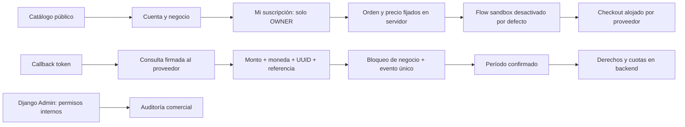

# Zenvik — Etapa 15: capa comercial SaaS

Fecha: 5 de noviembre de 2026, America/Santiago. Trabajo exclusivamente local.

**Implementado y probado localmente:** catálogo configurable, planes/versiones/precios, suscripciones independientes por negocio, períodos y estados, pruebas opcionales, solicitudes de cambio, cancelación, cuotas transaccionales, derechos en backend, historial de pagos, auditoría y administración interna. Checkout y confirmación mediante adaptador exclusivo Flow sandbox, con pruebas de transporte/contrato y proveedor simulado.

**No probado en el sandbox externo:** faltan cuenta y credenciales sandbox, callback HTTPS alcanzable y validación con Flow. **Recurrencia automática nativa, enrolamiento, cancelación remota, reembolsos externos, homologación contractual y producción pendientes.** No se realizaron cobros, no se almacenaron tarjetas y no se afirma que Zenvik pueda comercializarse públicamente sin las dependencias descritas.

## Auditoría inicial y dependencias anteriores

Se inspeccionaron README, OPERATIONS, informes STAGE-8 a STAGE-14, código y pruebas de accounts, businesses y attendance; páginas, componentes, catálogo de navegación, proxy y runners. Se comprobó implementación real de planificación avanzada, fichas/vinculación de cuentas, portal personal, asistencia puntual, supervisión, incidencias, evidencia inmutable y notificaciones. No existían planes, precios, suscripciones ni facturación. La raíz pública redirigía a `/app`; se conserva y se añade `/planes` accesible desde el selector de negocios.

- Se reutilizan Business, Membership, User y Employee; no se duplican identidades ni negocios.
- El negocio activo es el UUID de ruta validado contra la membresía; BusinessGate remonta contenido por negocio y useResource cancela peticiones anteriores.
- Sesiones Django, cookies HttpOnly, CSRF, aislamiento, rate limiting PostgreSQL, proxy fijo y roles existentes se conservan.
- OWNER de un negocio no es administrador global. ADMIN no recibe permisos financieros automáticamente.
- Persisten dependencias previas: recuperación de contraseña/verificación de correo, staging HTTPS, roles PostgreSQL separados, respaldos externos/observabilidad y revisión legal de asistencia. Los planes no resuelven ni ocultan esas brechas.
- El reporte de etapa 14 documenta límites de uso oficial de asistencia. Esta entrega no altera originales, no la presenta como reloj autorizado y no ofrece funcionalidades laborales inexistentes.

## Arquitectura



Roles, identidad, suscripción y funcionalidades son dimensiones separadas. Una membresía autoriza un negocio; la capa comercial restringe operaciones nuevas dentro de ese acceso. Una suscripción nunca permite saltarse el rol ni consultar otro negocio.

## Modelos

| Modelo | Función |
|---|---|
| Plan | Código estable, nombre/descripcion editables, publicación y orden |
| PlanVersion | Versión inmutable, vigencia, funcionalidades, límites y días de prueba |
| Price | Precio en pesos CLP enteros, versión, período mensual/anual, vigencia y publicación; importe histórico inmutable |
| Subscription | Relación uno-a-uno con Business; versión/precio, estado, período, revisión, prueba usada, cancelación programada y continuidad previa |
| PaymentOrder | Snapshot del precio, período reservado, revisión esperada, UUID idempotente, estado y referencia del proveedor |
| ProviderEvent | Evento verificado y deduplicado; no guarda token ni cuerpo financiero |
| SubscriptionChange | Solicitud de prueba, cambio, cancelación o continuidad, actor y fecha de efecto |
| BillingAudit | Evidencia append-only de cambios comerciales, IDs, estados y revisiones |
| BusinessRegistration | Clave por usuario y huella para no duplicar un negocio al reintentar el formulario |

No hay PAN, CVV, datos de tarjeta, credenciales ni callbacks íntegros en estos modelos. No se añaden dependencias de aplicación.

## Migraciones y conservación

Migraciones aditivas de `billing`:

1. `0001_initial`: modelos, claves y restricciones iniciales.
2. `0002_catalog_and_integrity`: catálogo informativo inicial, continuidad de negocios previos y triggers de evidencia/precios/versiones/órdenes.
3. `0003_businessregistration`: registro idempotente de negocios.
4. `0004_remove_subscription_billing_subscription_period_and_more`: período completamente ausente o con ambos extremos válidos.
5. `0005_subscription_integrity`: empresa inmutable, coherencia precio/versión y datos requeridos para estados vigentes.
6. `0006_paymentorder_billing_provider_reference_unique`: referencia remota única por proveedor, excluyendo marcadores internos.

Aplicadas a PostgreSQL local. `scripts/activate_stage15.py` verificó **conteos y SHA-256 idénticos en los 22 modelos anteriores**. Evidencia: `.artifacts/stage15-migration.json` y `.artifacts/stage15-migration.log`. El JSON contiene solamente conteos/hashes y versión del motor, no filas ni secretos. La prueba de migración separada crea un negocio/ficha históricos en base temporal, incorpora billing y comprueba conservación y continuidad de acceso.

No se borraron ni recrearon volúmenes/bases operativas; no se cambiaron credenciales. Las bases de tests tienen UUID propio y se retiran mediante los runners existentes. No se usaron datos operativos como fixtures.

## Planes iniciales y publicación

| Plan | Presentación inicial |
|---|---|
| Básico | Trabajadores, turnos, permisos y portal personal |
| Profesional | Base anterior y herramientas operativas de asistencia/ubicaciones/incidencias/notificaciones/exportación |
| Premium | Herramientas operativas y reportes |

Los nombres, descripciones y publicación se administran en Django Admin. El catálogo se publica **solo como información**, con **cero precios, límites comerciales vacíos y prueba de cero días**; no se insertan precios ficticios ni límites definitivos. Sin precio, la interfaz muestra «Precio por definir / Sin contratación activa». No hay pruebas gratuitas implícitas ni suscripciones pagadas creadas por el seed.

Cada versión conserva sus derechos y límites. Para cambiar condiciones se crea una versión nueva; para cambiar un importe se crea otro Price y se retira la publicación del anterior. Una suscripción conserva su referencia histórica. Los cambios de nombre del Plan son editoriales, no un cambio retrospectivo de importe.

Los negocios actuales y los nuevos sin condiciones comerciales aprobadas tienen `legacy_access=True`, estado PENDING y acceso previo conservado. **No significa ACTIVE, plan gratuito comercial ni contrato pagado.** Esta continuidad es explícita y visible; la transición comercial exige una prueba seleccionada habilitada o pago verificado. Antes de lanzar al público debe definirse comercialmente la admisión de nuevos negocios; esta instalación no impone una cuota nueva arbitraria.

## Derechos, cuotas y concurrencia

Funcionalidades configurables: employees, shifts, leaves, worker_portal, attendance, geolocation, geofences, reports, exports, incidents y notifications. Los controles de escritura se ejecutan en permisos de API y en los servicios transaccionales relevantes; cuotas de trabajadores y administradores también se verifican en los guardados de modelos. Uso administrativo incluye OWNER/ADMIN activos con acceso habilitado. Las ubicaciones activas se validan antes de cambiar la política.

Las escrituras, confirmaciones y cambios usan el mismo bloqueo de fila Business. Se prueban con conexiones concurrentes creación de trabajadores y callbacks duplicados. El límite se verifica al crear/reactivar, sin impedir conservar registros existentes por encima del nuevo límite. Reducir un plan no elimina fichas ni marcaciones. No se implementa una cuota de almacenamiento porque no existe un módulo comercial de archivos que medir.

Política de recuperación: lectura de originales, fichas, turnos, comprobantes, solicitudes e historial autorizados permanece disponible aun sin funcionalidad contratada o tras vencimiento/suspensión. La exportación CSV de recuperación mantiene roles y controles de privacidad y no tiene bloqueo comercial. El reporte de pantalla sí exige `reports`. Las herramientas de consulta no deben confundirse con autorización para crear nuevas marcaciones o configurar geocercas. El portal personal conserva acceso a sus registros, no amplía su scope.

Las garantías se aplican a los flujos soportados de aplicación/administración; SQL privilegiado puede omitir reglas de cuota, y un superusuario PostgreSQL puede modificar triggers. No se afirma RLS, aislamiento frente al operador de infraestructura ni invulnerabilidad ante acceso directo a la base.

## Ciclo de vida

- PENDING: sin contratación confirmada. La continuidad previa se muestra por separado.
- TRIALING: solo si la versión publicada habilita días de prueba; una prueba por negocio. No hay cobro automático al terminar.
- ACTIVE: únicamente tras pago verificado para un período, con precio y versión coherentes.
- PAST_DUE: fallo de un pago posterior; se conserva acceso al período ya pagado hasta su fin, sin gracia inventada.
- CANCELLED: cancelación efectiva al finalizar el período.
- EXPIRED: período terminado sin renovación confirmada.
- SUSPENDED: decisión de operador interno auditada; conserva datos y recuperación.

La cancelación no cobra ni reembolsa y puede retirarse antes de vencer. Después se requiere otro pago para activar un período; no basta un botón de reactivación. Los operadores pueden suspender/reanudar, pero la reanudación exige un período válido ya pagado o de prueba. No pueden crear una activación pagada desde un campo editable de Admin.

Los períodos mensuales/anuales usan calendario UTC, ajustando el último día de mes (incluidos años bisiestos). La presentación se hace en America/Santiago. Una renovación pagada por anticipado se reserva y no reemplaza antes de tiempo el plan actual. Al finalizar, solo se aplica si existe una orden PAID para el siguiente período y la revisión es compatible. `reconcile_billing` procesa vencimientos y reservas sin cobrar; también se concilian al consultar el estado/derechos vencidos.

Los cambios de plan son solicitudes con efecto previsto al próximo período. No hay prorrateo ni cargos automáticos de diferencias. Se aplican los derechos de la versión elegida después del pago confirmado del período. Una confirmación tardía incompatible se registra como `PAYMENT_REVIEW_REQUIRED` sin activar derechos indebidos; el operador debe resolver el caso y, si corresponde, un reembolso con el proveedor. Solicitudes aún no aplicadas se muestran como registradas, sin anunciar un cambio efectivo.

## API

| Ruta | Acceso |
|---|---|
| GET `/api/v1/billing/plans/` | Público; catálogo publicado y estado real del checkout |
| GET `/api/v1/businesses/{id}/billing/` | OWNER: plan, período, estado, consumo, límites, solicitudes |
| GET `.../billing/payments/` | OWNER: órdenes paginadas del negocio |
| POST `.../billing/checkout/` | OWNER: precio publicado, UUID de petición y revisión; sin montos cliente |
| POST `.../billing/changes/` | OWNER: TRIAL, CHANGE, CANCEL o REACTIVATE con revisión/UUID |
| POST `/api/v1/billing/flow/callback/` | Señal sin sesión, verificada consultando Flow en servidor |

Se rechazan campos desconocidos. No-store, rate limiting y CSRF continúan activos para clientes autenticados. Solo el callback omite sesión/CSRF de navegador, porque la autoridad se establece con una consulta firmada al proveedor; el simple token entrante no constituye pago. El proxy permite explícitamente catálogo/callback y rutas privadas de negocio, sin exponer `/admin`.

Estado 400 para entrada inválida, 403 rol/derecho/CSRF, 404 uniforme para negocio ajeno/desconocido, 409 revisión/idempotencia incompatible, 429 límite y 503 proveedor no configurado/no disponible.

## Pagos: implementación y límites

Evaluación oficial de Transbank Webpay/Oneclick, Mercado Pago y Flow: [STAGE-15-PAYMENTS.md](STAGE-15-PAYMENTS.md). Se eligió Flow sandbox por su API REST, separación de ambientes y producto de suscripciones. La elección no equivale a contratación.

Implementado en `billing/providers.py`:

- Base fija `https://sandbox.flow.cl/api`; no existe selección productiva. Modo disabled predeterminado, validación de configuración rechaza pagos en producción.
- Firma HMAC-SHA256 con parámetros ordenados; TLS validado, sin seguir redirects, timeout de 10 segundos y límite de respuesta de 64 KiB.
- Checkout alojado mediante `payment/create`; estado mediante `payment/getStatus`.
- Validación server-to-server de `commerceOrder`, `flowOrder`, monto Decimal exacto, CLP y estado conocido.
- Snapshot de orden, UUID idempotente, una intención pendiente por revisión, evento y referencia únicos, bloqueo del negocio y no regresión de PAID ante mensajes antiguos.
- Las llamadas de red ocurren fuera de transacciones. Un timeout al solicitar checkout deja marcador de resultado incierto; **no se repite automáticamente payment/create**. Se devuelve conflicto en reintentos para revisión, evitando órdenes externas duplicadas sin garantía de idempotencia del proveedor.
- El retorno del navegador nunca activa la suscripción. Los tokens no se almacenan ni registran en auditoría. No se registran URLs firmadas, cuerpos financieros ni datos de tarjeta.

**`payment/create` es un pago único. No se implementó la recurrencia automática nativa de Flow.** La arquitectura local prepara períodos, renovación confirmada y separación de proveedor, pero el enrolamiento `customer/register`, su verificación, `subscription/create`, asociación del cliente/contrato remoto y conciliación de importes recurrentes requieren implementación y pruebas externas posteriores. Cancelar localmente no cancela un contrato remoto que esta versión nunca crea. El informe de proveedores detalla esa secuencia para evitar confundir ambas integraciones.

Sin credenciales no se contactó a Flow. El proveedor simulado existe exclusivamente dentro de las fixtures del E2E y no puede activarse con una variable de entorno del producto. En navegador se intercepta el host externo antes de navegar: no se envían peticiones de cobro a terceros.

## Frontend y administración

- `/planes`: comparación responsive, funcionalidades, límites publicados, precio/frecuencia cuando existen, FAQ y estado sin contratación. Enlaces para iniciar sesión/registro y escoger negocio.
- `PlanCards` y `PublicPlans` reutilizan tokens, tipografía, botones y avisos; no incorporan otro sistema visual ni dependencias.
- `SubscriptionWorkspace`: consulta por negocio, plan/estado/período, consumo real, selección con resumen, confirmaciones de prueba/cambio/cancelación, historial paginado, errores recuperables y estados vacíos.
- `lib/billing.ts`: contratos, etiquetas, formato CLP y validación estricta de checkout sandbox. Solo el código público del plan se conserva temporalmente como preferencia de navegación, nunca derechos, tarjetas ni secretos.
- Selector/registro de negocio mantienen la intención de plan después del login; el registro usa una clave estable mientras el contenido no cambie para evitar duplicados por reintentos.
- Módulo «Mi suscripción» solo para OWNER. ADMIN/EMPLOYEE no montan peticiones de finanzas y reciben rechazo si manipulan rutas o API.
- Área interna en `/admin/billing/`: requiere staff activo, `billing.operate_billing` y permisos de modelo. Catálogo editable/versionado; pagos, eventos y auditoría de solo lectura; suspensión/reanudación auditadas y limitadas. No se promovieron cuentas operativas ni se crearon credenciales compartidas.

## Validación y evidencia

| Verificación | Evidencia |
|---|---|
| Regresión backend: 306 descubiertas, 298 aprobadas y 8 wrappers de navegador separados | `.artifacts/stage15-backend-final.log` |
| Comprobación final focalizada: 44 descubiertas, 43 aprobadas y 1 wrapper E2E separado; incluye la nueva prueba de segunda intención inicial pendiente | `.artifacts/stage15-billing-final.log` |
| Regresión navegador: 8 fases Django aprobadas; 41 escenarios Playwright | `.artifacts/stage15-e2e-regression.log` |
| Flujo comercial focalizado | `.artifacts/stage15-billing-e2e.log` |
| Frontend: 108 pruebas, 16 archivos | `.artifacts/stage15-vitest.log` |
| TypeScript / ESLint | `.artifacts/stage15-typecheck.log`, `.artifacts/stage15-lint.log` |
| Build Next.js | `.artifacts/stage15-build.log` |
| Migraciones y conservación de datos | `.artifacts/stage15-migration.log`, `.artifacts/stage15-migration.json` |

Las cifras de la suite focalizada se solapan con la regresión, no se suman como casos distintos. Los wrappers omitidos por el runner backend sí se ejecutan en el runner de navegador. Los skips de Playwright en la fase general corresponden a fixtures especializadas ejecutadas en sus fases respectivas; no se desactivaron casos para conseguir aprobación.

Cobertura nueva: catálogo publicado/vigente, inmutabilidad de versiones/precios por ORM y SQL, reglas de períodos, pruebas habilitadas, activación verificada, pagos fallidos/duplicados/fuera de orden, importe/moneda/ref incorrectos, callback falso, CSRF, aislamiento, privilegios internos, conservación de lectura/exportación, límites de trabajadores/ubicaciones/administradores, reactivación de fichas, downgrade sin eliminación, cancelación/reactivación/vencimiento, reserva de renovación, estado incoherente, idempotencia de registro y concurrencia real. Se probaron firma/contrato Flow con transporte controlado; eso no prueba su servicio externo.

El recorrido comercial crea un negocio sintético, selecciona precio de fixture, abre checkout simulado, confirma y repite el callback, verifica estado/pago, aplica la cuota y rechaza EMPLOYEE y negocio ajeno. Se revisaron capturas sintéticas de escritorio y móvil de 320 px:

- `.artifacts/stage15/stage15-plans-desktop.png`
- `.artifacts/stage15/stage15-subscription-320.png`

No se afirma certificación WCAG ni pruebas de carga de producción. Los logs conservan intentos iniciales fallidos: falta de Chromium, rutas nuevas rechazadas por el proxy, error en fixtures y carrera al leer respuesta durante navegación. Se corrigieron sin relajar controles. Los primeros tests de regresión afectados por cambios simultáneos del grafo de migraciones se repitieron con el esquema estable. Los avisos NO_COLOR/FORCE_COLOR y broken pipe de cierre no son fallos de aserción.

## Configuración y operación pendiente

El `.env` existente se conserva íntegro. `.env.example` documenta únicamente nombres/valores vacíos. Por defecto `BILLING_PAYMENT_MODE=disabled`. Para una futura prueba externa se necesitan claves sandbox independientes, `FLOW_SANDBOX_CONFIRMATION_URL` HTTPS alcanzable y `FLOW_SANDBOX_RETURN_URL` controlada, además de precios aprobados publicados por el operador. No utilizar credenciales reales ni suponer que localhost es accesible para el proveedor. No se creó un túnel ni servicio pago.

Desde `apps/api`:

```powershell
.\.venv\Scripts\python.exe run_backend_tests.py
.\.venv\Scripts\python.exe manage.py reconcile_billing
.\.venv\Scripts\python.exe run_browser_tests.py
```

Desde `apps/web`: `npm.cmd run typecheck`, `npm.cmd run lint`, `npm.cmd test`, `npm.cmd run build`. Playwright requiere Chromium de su versión fijada; se instaló en la caché del usuario al faltar el ejecutable. No se modificó la política de ejecución de PowerShell ni se instalaron paquetes globales.

Un despliegue futuro necesita un planificador de conciliación sin dependencia de sesión local, monitor de eventos atascados, revisión de incidencias de pago, política de reintentos y operación/reembolsos. No se añadió una tarea de cobros automáticos.

## Riesgos, decisiones comerciales y tributarias

- Aprobar importes, moneda adicional si se necesitara, periodicidad, impuestos, reglas de trial, cuotas, uso excedido y admisión de nuevos negocios. No hay decisiones definitivas inventadas.
- Contratar/habilitar producto recurrente y condiciones bancarias/comerciales con el proveedor; confirmar comisiones y homologación que corresponda. Las tarifas públicas del informe no son promesa contractual.
- Completar pruebas externas de enrolamiento, recurrencia, confirmación, fallos, reintentos, cancelación y reembolso; revisar vinculación entre cliente, contrato remoto e identidad local.
- Resolver órdenes de resultado incierto y pagos con revisión incompatible mediante una operación explícita; esta entrega conserva la evidencia y no emite reembolsos automáticos ni cobra otra vez.
- Una referencia interna, comprobante de proveedor o recurso `invoice` remoto **no es una boleta/factura autorizada por el SII**. Definir emisor/proceso DTE autorizado, datos tributarios y conciliación tributaria antes de vender.
- La auditoría SQL no impide modificaciones por un superusuario de infraestructura. Revisar separación de roles, retención y supervisión externa.
- Persisten las 10 vulnerabilidades moderadas reportadas por npm durante preparación local; no se ejecutó una actualización forzada que alterase el lockfile. Esto requiere revisión específica antes de producción.
- La cobertura visual usa Chromium y fixtures. No sustituye auditoría integral de accesibilidad, seguridad, capacidad ni evaluación legal del uso de asistencia.

## Checklist de aceptación

| Criterio | Estado |
|---|---|
| Catálogo funcional y precios configurables | Implementado y probado localmente; tres planes sin precios ficticios |
| Suscripción independiente por negocio y control de estados | Implementado, restricciones SQL y pruebas |
| Cuotas backend y funcionalidades comerciales | Implementado; concurrencia y recuperación autorizada verificadas |
| Arquitectura/adaptador de pagos | Implementado para checkout y confirmación Flow sandbox; desactivado |
| Eventos seguros e idempotencia | Probados con transporte/proveedor controlados; sandbox externo pendiente |
| OWNER consulta y solicita cambios | Implementado; E2E y autorización backend |
| Administración interna protegida | Implementada en Django Admin, permisos explícitos y auditoría |
| Cambios sin pérdida de datos | Verificados por tests y hashes de activación local |
| Multiempresa y responsive | Probados en API/E2E y 320 px |
| Regresión relevante | Backend, frontend, navegador y build aprobados según evidencia |
| Dependencias de cobros reales | Documentadas; no habilitados |
| Recurrencia automática nativa del proveedor | Pendiente de implementación/configuración y pruebas externas |
| Sandbox externo | Pendiente de credenciales y callback alcanzable |
| Homologación y producción | Pendientes; no se declara entrega productiva |
| Emisión tributaria | Pendiente de proceso/integración autorizada |

## Recomendaciones para Etapa 16

Definir condiciones comerciales y transición desde continuidad local; completar el contrato recurrente de Flow con enrolamiento verificado y conciliación de importes; operar cancelaciones/reembolsos y pagos inciertos; integrar DTE autorizado; preparar staging HTTPS, rol migrador/runtime, backups/restauración y observabilidad. Repetir regresión, pruebas sandbox externas y revisión de seguridad antes de solicitar autorización de cobros reales.

No se ejecutaron comandos Git, commits, push, despliegues, cobros reales, cambios de credenciales ni eliminación de datos operativos.
