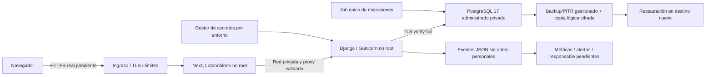

# Zenvik — Etapa 16: infraestructura y operación

Fecha de cierre: **5 de noviembre de 2026, America/Santiago**. Preparación y validación locales; no se crearon recursos cloud, no hubo despliegues, cambios de DNS, cobros, comandos Git ni cambios de credenciales existentes.

## Resumen y alcance real

Se prepararon imágenes de producción API/web, CI de verificación, configuración segura por entorno, healthchecks, telemetría sin datos sensibles, separación PostgreSQL owner/migrador/runtime, backups cifrados y restauración aislada, alertas propuestas y procedimientos de release/rollback/recuperación.

**IMPLEMENTADO Y PROBADO localmente:** builds, contenedores no root, pruebas de salud/fallo/parada, dependencias auditadas, configuración de seguridad, privilegios en PostgreSQL 17 sintético, restauración cifrada, regresión funcional y carga acotada.

**IMPLEMENTADO SIN VALIDACIÓN REMOTA / DOCUMENTADO:** plantillas de staging/producción, workflow CI no publicado ni ejecutado en GitHub, job de respaldo externo desactivado, integración con gestor de secretos/ingreso del proveedor y diseño de observabilidad/alertas.

**BLOQUEADO por ausencia de infraestructura autorizada:** HTTPS/certificados y cookies a través de un ingreso real, IAM/red privada reales, respaldo externo/PITR, entrega de alertas, recuperación/rollback cloud y sandbox externo. No se declara producción habilitada ni controles operativos activos que solo estén preparados.

## Auditoría inicial

Se revisaron monorepo, README, OPERATIONS, SECURITY (informe de etapa 7; no existe `docs/STAGE-7.md`), informes 8–15, Docker Compose, settings, proxy, roles, evidencia de asistencia, facturación y runners. No había Dockerfiles ni CI. Existían sesiones/CSRF, restricciones multiempresa, triggers de evidencia, pruebas de concurrencia, procedimiento de restore sintético y logs mínimos, pero no respaldos externos ni colector/alertas remotos verificados.

Riesgos confirmados de partida:

- La conexión local de desarrollo usa un rol PostgreSQL con privilegios excesivos para producción. No se cambió ese rol ni su contraseña.
- Runtime local Python 3.15 no figura soportado por Django 5.2; se preparó y probó **Python 3.13.18/Linux** para despliegue.
- npm reportaba diez avisos moderados asociados a `minimatch` y dependencias de lint; el build de imágenes reveló además paquetes vulnerables heredados de las bases, invisibles a la auditoría del proyecto npm.
- No había verificación del peer real al confiar X-Forwarded-Proto. Se conservó la política de no confiar en IP/Host enviados por cliente.
- Siguen pendientes respaldo externo, alertas entregadas, HTTPS real, recuperación de cuenta/correo y límites de autenticación por cliente en el ingreso. No se presentan como solucionados por un archivo de configuración.

No se duplicaron modelos ni módulos. Esta etapa no tiene migraciones nuevas de la aplicación y no altera las reglas legales/operativas de asistencia ni habilita pagos reales.

## Arquitectura cloud recomendada

Recomendación bajo los controles implementados: **dos servicios Cloud Run y Cloud SQL PostgreSQL 17 privados en Santiago**, con CA compartida/DNS compatibles con `verify-full`, secretos separados e ingreso HTTPS controlado. Sin Kubernetes. Los contenedores siguen siendo portables; no se preparó una dependencia obligatoria de GCP dentro de los modelos.

Render simplifica operación, pero su PostgreSQL interno no soporta `verify-full`; no se debilitó el guard para adaptarse. Azure Container Apps + PostgreSQL Flexible en Chile Central es una alternativa; verificar SKU, red y respaldo de desastre. AWS São Paulo, Vercel con backend separado y Cloudflare como borde también fueron comparados. La región AWS Chile no se asumió disponible.

La [comparación completa y fuentes oficiales](STAGE-16-CLOUD.md) incluye regiones, PITR, costos públicos verificables y límites. **No hay total mensual aprobado/verificado:** depende de tallas, base, red, logs, backups, transferencia, retención y disponibilidad. No se inventaron precios de instancias ni latencia desde Chile.

Cloud Run requiere resolver identidad/red para la llamada Next→Django; el proxy actual no emite tokens IAM automáticamente. Tampoco basta asignar una URL de servicio para considerarla privada. Es una validación remota pendiente, no un componente desplegado.

## Archivos y cambios

| Área | Archivos principales |
|---|---|
| Contenedores | `apps/api/Dockerfile`, `apps/web/Dockerfile`, `.dockerignore`, `infra/gunicorn.conf.py`, `infra/container_health.py` |
| Configuración | `apps/api/config/settings.py`, `deployment.py`, `.env.example`, `infra/compose.staging.yml`, `infra/staging.env.example`, `infra/production.env.example`, `infra/nginx.conf.template` |
| Salud y logs | `config/health.py`, `config/observability.py`, `config/urls.py`, `apps/web/src/app/health/{live,ready}/route.ts` |
| PostgreSQL | `infra/postgres/{bootstrap,grants,backup-grants}.sql`, `scripts/check_postgres_roles.py` |
| Backup y restore | `scripts/backup.py`, `backup_job.py`, `verify_encrypted_restore.py`, `scripts/tests/test_backup.py`, `infra/backup/*` |
| CI/seguridad | `.github/workflows/ci.yml`, `.gitleaks.toml`, `pyproject.toml`, `requirements-operations.txt`, `apps/api/requirements-production.txt` |
| Verificaciones | `scripts/{security_scan,verify_configuration,validate_infrastructure,container_smoke,run_container_backend_tests}.py`, `config/test_operations.py`, `config/test_performance.py`, `apps/web/e2e/health.spec.ts` |
| Correcciones | `apps/web/package.json` y lockfile, `next.config.ts`, `accounts/turnstile.py`, `billing/providers.py` |
| Operación | `infra/README.md`, este informe, `STAGE-16-CLOUD.md`, notas de actualización en README/SECURITY/OPERATIONS |

Se conservaron el `.env` existente, el volumen y la base operativa, `compose.yml` local y las credenciales. Las claves/roles de ensayos son nuevos y efímeros, no una rotación de cuentas existentes. Las herramientas de auditoría se instalaron en `.artifacts/ops-venv`, sin instalaciones globales ni cambio de ExecutionPolicy.

## Entornos, secretos y Django

Desarrollo conserva HTTP local y dotenv. Staging/producción exigen modo seguro, dotenv desactivado e inyección de secretos. Un entorno desconocido o una etiqueta staging/production con modo inseguro impide el inicio. `FileAwareEnv` soporta archivos secretos sin incorporarlos a imágenes ni argumentos.

Producción: DEBUG=False, hosts explícitos, orígenes CSRF HTTPS validados, SSL redirect, cookies Secure/HttpOnly/Lax, HSTS de un año sin includeSubDomains/preload, nosniff, same-origin y DENY. No hay CORS abierto. Registro público y Admin permanecen cerrados por defecto. Se mantienen sesiones, controles multiempresa, CSRF y reservas de rate limiting PostgreSQL.

`TrustedProxyMiddleware` valida CIDR del peer de red antes de aceptar X-Forwarded-Proto y elimina otras cabeceras forwarded de cliente. No admite CIDR abierto /0 como configuración segura. El ingreso debe sobrescribir cabeceras y Django permanecer privado. Esto no resuelve la atribución de IP real del cliente: el límite por IP de login sigue compartido detrás de Next; configurar y probar control en el borde antes de abrir un piloto.

DB: `verify-full` obligatorio en modo seguro, CA/hostname verificados, connect timeout configurable y conexiones persistentes opcionales acotadas. No se introdujo pooling sin evidencia que lo requiera. Un conector Unix socket de un proveedor no debe activarse rebajando estas guardas sin diseño/revisión específica.

Se ejecutó realmente **`manage.py check --deploy --fail-level WARNING`** con configuración sintética segura. Retorna 1 por **W005 y W021**, intencionales porque no se habilitan includeSubDomains ni preload sin validar dominios. No hubo otros avisos/errores; ninguno se silenció en settings. La clasificación del script conserva el código y las advertencias completas en `.artifacts/stage16-deploy-check-cli.log` y JSON. **No demuestra TLS real.**

El adaptador Flow sandbox puede prepararse también en staging con settings seguros; el entorno production sigue rechazando activación de pagos. Sigue desactivado en los ejemplos y en el entorno actual. No se cargaron credenciales externas ni se efectuaron llamadas de cobro.

## Next.js y contenedores

Next construye standalone cuando `NEXT_STANDALONE=true` en Docker; el build local conserva su forma habitual. Se mantienen Host/origen exactos, proxy fijo, límites de cuerpo/respuesta/plazo, cookies y no-store de API. Se añadieron probes y calidad de imagen 85 autorizada explícitamente, corrigiendo el aviso anterior. No se añadió ninguna variable pública con secretos.

La CSP continúa parcial (base/object/frame/form); una política completa de scripts con nonce sigue pendiente y no se declara solucionada. Autorización sigue en Django, no en un middleware de interfaz.

Imágenes finales oficiales por digest: **Python 3.13.18 / Alpine 3.24.3** y **Node 24.22.2 / Alpine 3.24.3**, amd64 ensayado. Se verificó disponibilidad de wheels musllinux; no se presume soporte ARM por tener un manifest multiarch.

- Builds multistage; requisitos/lockfile fijados, versiones de herramientas explícitas y bases por SHA-256. No se promete reproducibilidad bit a bit de herramientas sin un lock de hashes completo de Python.
- Runtime API UID/GID 10001; web usuario node. Código propiedad root; solo cache/tmp pueden escribirse. Sin pip/setuptools/wheel en API ni npm/corepack/yarn en web final.
- Compose preparado: raíz de archivos read-only, capacidades eliminadas, no-new-privileges, tmpfs, límites CPU/memoria configurables, logs rotados y señales/gracia de parada.
- API/DB sin puertos públicos en la plantilla. No se arrancó la configuración de staging; solo se validó con `config --quiet` para ambos ejemplos.
- Smoke real en contenedores sin red/puertos: liveness 200; dependencia inaccesible produce readiness 503; login HTML y optimización nativa de imagen 200 en web. Parada API ≈0,98 s, web ≈0,24 s en este ensayo; no son SLA.

La imagen Gunicorn inicialmente no iniciaba por un logger raíz incompleto; se corrigió y se repitió el smoke. Las alternativas Debian evaluadas conservaban avisos de distribución sin parches publicados; se eligió la base mínima compatible, se retiraron instaladores innecesarios y se repitieron regresión y escaneo. Los JSON anteriores se conservaron, sin ocultar CVE ni usar `--ignore-unfixed` para aprobar.

## PostgreSQL y privilegios

**IMPLEMENTADO Y PROBADO en base/roles UUID aislados, PostgreSQL 17.11:** owner NOLOGIN, migrador separado con SET ROLE owner, runtime sin superusuario/creación de roles/bases/replicación/BYPASSRLS. Se aplicó todo el esquema con el migrador; runtime pudo SELECT/INSERT/UPDATE, pero no DDL, creación de roles/bases ni cambios en `django_migrations`.

Bootstrap aborta si la base conectada no coincide o no está vacía; no sobrescribe roles existentes. Grants posteriores verifican destino. Los privilegios por defecto corresponden al propietario del esquema. Timeouts iniciales se prepararon en el rol; no son reglas comerciales ni capacidad garantizada. El rol lector de backups tiene plantilla separada y no permisos de restaurador.

**La cuenta local de desarrollo sigue siendo superusuario; no se modificó.** En una instalación real se deben crear roles propios y reconciliar propietarios/grants después de restaurar, antes de promover. El ensayo de restore no demuestra por sí solo los permisos del proveedor administrado. No hay RLS: se conserva aislamiento de aplicación, y SQL privilegiado no es una API multiempresa segura.

## CI y estrategia de release

Workflow preparado con token contents:read y Actions oficiales por commit inmutable, verificados contra sus releases. No tiene deploy/push de imágenes ni configuración de secretos remotos. Comprueba:

- Python 3.13, PostgreSQL 17, requisitos, Ruff de corrección sobre backend/scripts y formato incremental de infraestructura.
- Settings/secret scan, schema sin migraciones pendientes de generar, suites backend, roles y restore cifrado.
- Node 24, npm ci, tipos, ESLint, Vitest, build y Playwright completo.
- Auditoría de requisitos base/runtime y npm; Bandit con bloqueo medio/alto; Gitleaks redactado sin historial; builds y Trivy con bloqueo alto/crítico.
- Probes y parada de imágenes, sin red ni puertos; evidencias JSON acotadas, no cuerpos/cookies/trazas.

**IMPLEMENTADO SIN VALIDACIÓN REMOTA:** YAML y política comprobados localmente, y los comandos sustanciales se ejecutaron en esta sesión; el workflow no fue publicado ni se afirma un run real de GitHub. Falta confirmar disponibilidad/permisos del runner, fuentes de paquetes y cuotas de la cuenta cuando se autorice.

El [runbook](../infra/README.md) define build, revisión y tarea única de migraciones, promoción manual por digest, probes/smoke, observación y rollback compatible. No hay migraciones automáticas por réplica. Si el esquema no permite volver atrás, se corrige hacia delante o se restaura en otro destino, nunca encima del activo. No se ejecutó un rollout ni un rollback real. Blue-green/rolling complejos quedan sujetos a necesidad medida, no se añadió Kubernetes.

## Backups y recuperación

**IMPLEMENTADO Y PROBADO:** backup custom pg_dump, AES-256-GCM autenticado en streaming, SHA-256 del cifrado, verificación de rutas/tampering/clave incorrecta y restore transaccional a base UUID nueva. El CLI no respalda una base operativa sin autorización explícita y entorno staging/production. La autenticación del cifrado termina antes de escribir a PostgreSQL.

Ensayo con datos sintéticos: **41 tablas iguales por hash**, constraints válidas y trigger de evidencia de asistencia aún inmutable; **16,58 s** en la última ejecución. Se crearon y retiraron solo las bases UUID de la prueba. No se extrajeron registros de la base del negocio ni se enviaron datos personales a almacenamiento externo.

**IMPLEMENTADO SIN VALIDACIÓN REMOTA:** job de carga cifrada S3/KMS con identidad de workload, env de ejemplo y timer systemd desactivados. **DOCUMENTADO:** retención propuesta 30 días, PutObject sin borrado para escritor, versionado/Object Lock, copia externa y políticas de acceso/clave. No se creó bucket, KMS, timer operativo ni se probó subida/descarga remota. Un backup subido sigue marcado como no restaurado hasta un ensayo.

Propuestas a acordar: copia lógica cada seis horas con jitter; RPO de seis horas más retrasos, y RTO de cuatro horas. **No son tiempos medidos/garantizados en producción.** PITR del proveedor, retención, pérdida de región/clave y recuperación completa deben probarse. El ensayo pequeño no incluye aprovisionamiento, DNS, secretos, validación humana ni retorno de clientes.

Responsables operativos/guardia no asignados: bloquear activación hasta nombrarlos. Restauración siempre en otro destino con cuenta de recuperación; revisar propietarios/grants, migraciones, evidencia, pagos y flujo de usuario antes de solicitar promoción. Un volumen Docker, réplica o checksum aislado no son un respaldo recuperable.

## Observabilidad, alertas y rendimiento

**IMPLEMENTADO Y PROBADO:** liveness sin DB, readiness SELECT 1 con fallo genérico, respuesta no-store, eventos JSON allowlist (servicio/método/familia/status/duración/tipo de error), rechazo de datos arbitrarios y ausencia de mensajes de excepción/URL/query/cookies/IP/GPS/UUID. Readiness no sustituye `migrate --check` ni el smoke de funcionalidades del release.

**DOCUMENTADO, no activo:** ingestión por monitoreo administrado; métricas CPU/memoria/conexiones/tareas/certificados, errores auth/asistencia/integraciones y estado de backups. `infra/observability/alerts.yml` prepara umbrales configurables y mínimos de muestras para evitar ruido. No se instaló una plataforma de observabilidad ni se probó entrega de alertas. No usar datos de trabajador/ubicación como etiquetas.

Carga local aislada real HTTP: **80 consultas de dashboard, concurrencia 4, diez trabajadores sintéticos, cero errores**, Python 3.13.18/Linux. Último resultado: p50 **163,59 ms**, p95 **249,38 ms**, máximo **280,75 ms**, duración **3,41 s**. No hubo carga sobre datos operativos ni sistemas de terceros. No prueba capacidad para miles de usuarios, reportes masivos, latencia chilena ni TLS real. Regresión existente conserva checks N+1, paginación, índices y concurrencia; no se añadieron índices/cachés sin necesidad medida.

El generador usa el LiveServer de pruebas de Django con API/ORM reales; no dimensiona por sí solo los workers Gunicorn ni el overhead del ingreso/TLS/telemetría productivos. La redacción de logs nativos del ingreso/Next debe validarse en el colector antes de retenerlos o exportarlos; las garantías del formatter local se limitan a API/Gunicorn.

## Auditoría DevSecOps y severidad

| Hallazgo | Severidad / tratamiento |
|---|---|
| Avisos de paquetes heredados de imágenes Debian evaluadas | Críticos/altos según scanner, sin afirmar explotación en esta app. Se cambió a bases mínimas compatibles; imágenes finales sin avisos altos/críticos en el scan ejecutado |
| minimatch 10.2.6 y árbol de tooling | Media: override fijado a 11.0.1, lockfile regenerado y regresión/lint/build aprobados; sin downgrade forzado de Next/ESLint |
| Confianza indiscriminada en proto de proxy | Media: CIDR de peer y eliminación de cabeceras no confiables, prueba de spoofing |
| Uso de credencial DB excesiva en desarrollo | Alta si se reutiliza en producción; **no resuelto en la base existente**, separación probada en recursos aislados y preparada para instalación nueva |
| Backups externos/PITR y alertas no activos | Alta operativa antes del piloto; scripts/diseño probados localmente, activación y evidencia externa pendientes |
| TLS, identidad/red cloud y cookies en ingreso real | Alta antes de exposición; configuración preparada y guardas probadas, validación real bloqueada |
| Rate limit IP compartido detrás de Next | Media pendiente: establecer control probado en el ingreso; no se confió en XFF de Internet para ocultarlo |
| CSP sin nonce y matriz de navegadores limitada | Baja/defensa adicional pendiente; no se presenta la prueba Chromium como certificación |
| W005/W021 de HSTS | Advertencias intencionales, no ocultas; no habilitar flags para obtener verde sin validar dominios |
| Hallazgos bajos de Bandit en herramientas CLI | 20 bajos en métricas, cero medios/altos; subprocess usa listas/sin shell y plazos, URL de proveedor fija con redirecciones rechazadas; no se afirma ausencia absoluta de riesgo |

Auditorías finales: npm **0 avisos**; PyPI base **8** paquetes y runtime adicional **2**, sin avisos conocidos; Trivy final API/web **0 altos/críticos**, OS y paquetes de lenguaje incluidos. Se usó la base Trivy descargada durante la sesión, luego offline con cachés separadas. No se filtraron CVE mediante ignore/VEX automático. Son verificaciones puntuales, no garantía futura.

Gitleaks y escaneo local de secretos no encontraron credenciales en el árbol de fuente revisado; valores actuales se compararon sin imprimirlos. **No se inspeccionó historial Git.** Dumps/keys/env/local tooling quedan fuera de imágenes/contexto y de artefactos CI. No se afirma que una búsqueda local detecte todos los secretos históricos o desconocidos.

## Resultados y evidencia verificable

| Verificación | Resultado y archivo |
|---|---|
| Backend Windows Python 3.15 (compatibilidad local, no runtime recomendado) | 315 descubiertas, 307 aprobadas, 8 wrappers aparte; `.artifacts/stage16-backend-windows.log` |
| Backend final imagen Python 3.13.18/Linux, PG17 | **317 descubiertas, 309 aprobadas, 8 wrappers aparte**; `.artifacts/stage16-backend-linux.log` |
| Configuración/billing focalizados tras guardas | 54 descubiertas, 53 aprobadas, 1 wrapper aparte; `.artifacts/stage16-operations-tests.log` (se solapan con la suite completa) |
| Navegador | **8 fases Django / 42 escenarios Playwright aprobados**; `.artifacts/stage16-e2e.log` |
| Frontend | **108 pruebas / 16 archivos**, tipos y ESLint; `.artifacts/stage16-{vitest,typecheck,lint}.log` |
| Build host y builds Docker | `.artifacts/stage16-web-build-host.log`, `stage16-api-build.log`, `stage16-web-build.log` |
| Contenedores no root/RO, probes, login, imagen y parada | `.artifacts/stage16-container-smoke.json` |
| Menor privilegio PostgreSQL 17 | `.artifacts/stage16-postgres-roles.json`, `stage16-postgres-roles.log` |
| Restauración cifrada e integridad | `.artifacts/stage16-encrypted-restore.json`; 4 pruebas unitarias en `stage16-backup-unit.log` |
| Check deploy real con configuración sintética | `.artifacts/stage16-deploy-check{,-cli}.log`, `stage16-deploy-check.json`; W005/W021 conservados |
| CI/Compose estáticos | `.artifacts/stage16-infrastructure-validation.json`; Compose `config --quiet` de staging/producción, sin arrancarlos |
| Dependencias | `stage16-npm-audit-{before,after}.json`, `stage16-python-base-audit.json`, `stage16-python-audit.json` |
| SAST/secretos | `stage16-bandit.json`, `stage16-gitleaks.log`; Ruff y scanner de fuente aprobados |
| Imágenes finales y antecedentes | `stage16-{api,web}-trivy.json`; antecedentes `*-trivy-before.json` y `*-trivy-trixie.json` |
| Carga sintética | `.artifacts/stage16-local-load.json` |

Los wrappers opt-in omitidos por backend sí se ejecutaron mediante el runner de navegador. Los skips por fixture de Playwright en la fase general se ejecutaron en fases especializadas. No se eliminaron ni desactivaron pruebas para conseguir aprobación. No hubo pruebas intrusivas contra terceros.

Identidad de artefactos locales ensayados (no publicados):

- API `zenvik-api:stage16`: `sha256:bd7621684347e93af8c041f25233c2583addb7e71fc449516858d47713aba020`.
- Web `zenvik-web:stage16`: `sha256:e37edc824a6a5b03572b280daf1a535ca2969ce43f22895fa349efe2ea574ace`.

Los Dockerfiles fijan también los digests de las bases. No se promete que otra compilación sin promoción del artefacto produzca el mismo digest de atestación. Actualizaciones futuras deben reconstruir, repetir pruebas y reauditar.

## Staging pendiente y checklist de aceptación

| Criterio | Clasificación |
|---|---|
| Arquitectura razonable y comparación de proveedores | **DOCUMENTADO**, fuentes oficiales y presupuesto pendiente |
| Desarrollo/staging/producción separados | **IMPLEMENTADO Y PROBADO** en guardas y plantillas; recursos reales pendientes |
| Django seguro | **IMPLEMENTADO Y PROBADO** local/sintético; TLS/CA/peer real **BLOQUEADO** |
| Next seguro y de producción | **IMPLEMENTADO Y PROBADO** build, proxy y smoke; CSP completa **PENDIENTE** |
| Contenedores | **IMPLEMENTADO Y PROBADO** en Linux/amd64; no desplegados |
| PostgreSQL mínimo privilegio | **IMPLEMENTADO Y PROBADO** en UUID aislado; aplicar a instalación real **PENDIENTE** |
| CI | **IMPLEMENTADO SIN VALIDACIÓN REMOTA**; controles sustanciales ejecutados localmente |
| Release/rollback | **DOCUMENTADO**, ejecución real **BLOQUEADA** por alcance |
| Backup/restauración | **IMPLEMENTADO Y PROBADO** sintético; offsite/PITR **PENDIENTE** |
| Monitoreo/alertas | Logs/probes **IMPLEMENTADOS Y PROBADOS**; colector/reglas/receptor **DOCUMENTADOS**, entrega **PENDIENTE** |
| DevSecOps | **IMPLEMENTADO Y PROBADO** en el alcance declarado; no certificación |
| Rendimiento | **IMPLEMENTADO Y PROBADO** para carga acotada; capacidad comercial **PENDIENTE** |
| Staging reproducible | **IMPLEMENTADO SIN VALIDACIÓN REMOTA**, plantillas y runbook |
| HTTPS/cookies/CSRF/login/módulos a través del ingreso real | **BLOQUEADO** sin entorno y dominio autorizados; localhost no acredita HTTPS |
| Sandbox proveedor / correo / recuperación de cuenta | **PENDIENTE**, no habilitado por infraestructura |
| Regresión relevante | **IMPLEMENTADO Y PROBADO**, omisiones opt-in ejecutadas aparte |

Antes de piloto deben probarse con infraestructura autorizada: certificados/cadena TLS, CA/hostname DB privado, secretos/rotación, cookies/CSRF a través del ingreso y sus CIDR, identidad Next→API, autorización multiempresa, marcaciones GPS en contexto seguro, incidencias, reportes, plan/sandbox, backup externo/restauración/PITR, alarmas y rollback. Datos de staging exclusivamente sintéticos salvo procedimiento autorizado distinto.

## Recomendaciones para Etapa 17

Aprobar proveedor/presupuesto/residencia, nombrar responsables y autorizar un staging aislado. Después validar red/IAM/TLS, activar y probar backups/alertas, definir RPO/RTO con datos representativos, ensayar rollback y revisar costos reales. Completar recuperación de cuenta, revisión de privacidad/retención y evaluación normativa de asistencia; mantener cobros productivos y lanzamiento sujetos a aprobación independiente. Considerar SBOM/firma de artefactos y revisiones periódicas de dependencias como siguiente control, sin atribuirlos a esta entrega.
